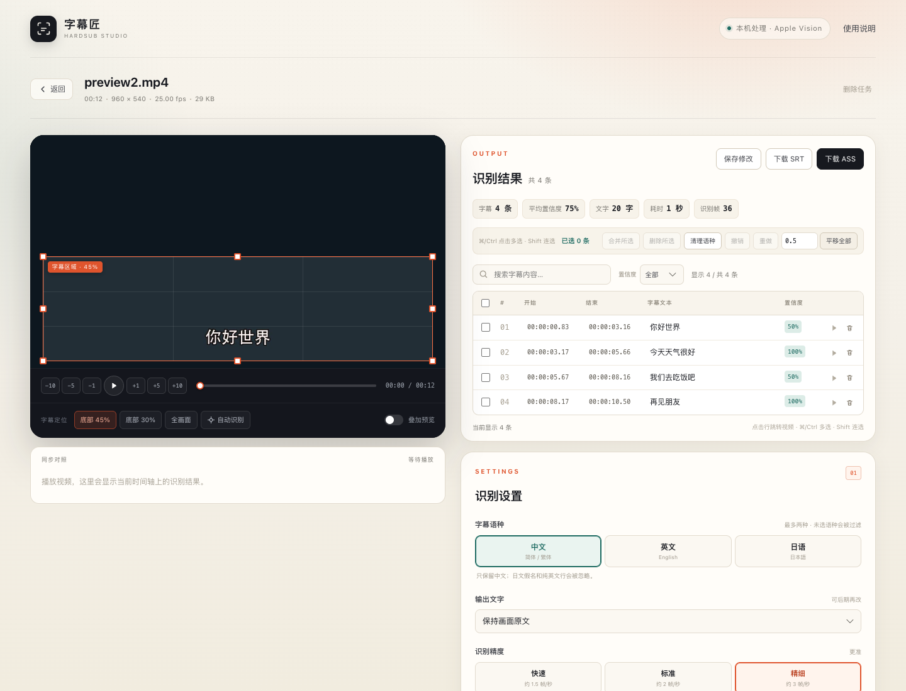
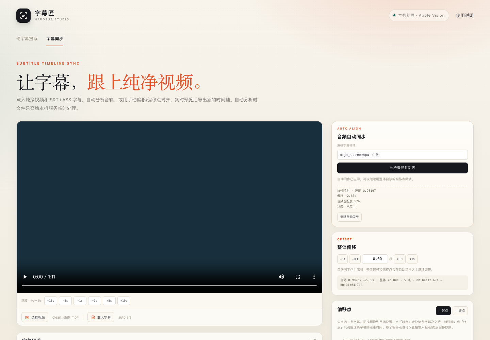
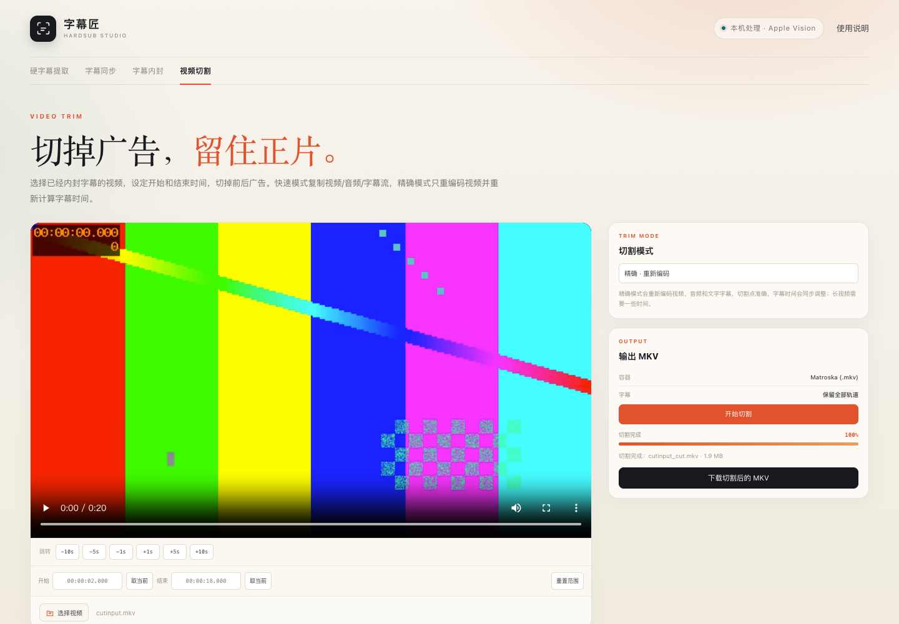

# 字幕匠 · HardSub Studio

[](https://github.com/WyattYiu/hard-sub-extractor/releases/latest)
[](https://github.com/WyattYiu/hard-sub-extractor)
[](https://github.com/WyattYiu/hard-sub-extractor)

**当前版本：v1.6.0** · [下载 Release](https://github.com/WyattYiu/hard-sub-extractor/releases/latest) · [更新日志](CHANGELOG.md)

从视频画面里提取**硬字幕**（烧录在画面上的字幕），生成可编辑、可下载的 **SRT / ASS** 文件；也可以把字幕同步到另一份纯净视频，封装成带字幕轨道的 MKV，或切掉带字幕视频前后的广告。识别、同步、内封和切割都在本机完成，视频不会上传到云端。

针对 Apple silicon 和中文场景做了优化：使用 macOS 原生 **Vision OCR**，支持中文、英文、日语，最多同时选择两种语言，并可按语种过滤识别结果。








## 功能

- 浏览器图形界面，无需安装客户端
- 上传后拖动框选字幕区域，也可自动检测
- 可自定义从视频的哪一分钟开始、到哪一分钟结束提取
- 中文 / 英文 / 日语，最多同时选择两种语言
- 只保留所选语种，中文模式下自动忽略日文假名和纯英文行
- 「过滤画面原有文字」自动排除台标、招牌、异常位置文字
- 双行/双语字幕会按时间自动合并，减少同一句被拆成两条单行
- 保留字幕中的空格，例如「是的 自慰」不会变成「是的自慰」
- 低分辨率视频会自动 2× 放大后再交给 Vision OCR，提高小字识别率
- 时间轴自动切分，边界采样做了防提前/防提前结束校正
- 字幕同步 tab 支持音频自动对齐、整体偏移、多个起止偏移点（起点联动后续字幕）和 ±1/5/10 秒跳转，方向键 ←/→ 每次 5 秒
- 浏览器无法播放的 MP4 编码可点「兼容预览」，由本机 ffmpeg 生成 H.264/AAC 预览
- 新增「字幕内封」tab：纯净视频 + SRT/ASS 封装为 MKV，视频/音频不重编码，字幕可设语言、标题和默认轨道
- 字幕内封显示真实上传/封装进度
- 新增「视频切割」tab：切掉前后广告，保留内封字幕；可快速流复制或精确重编码
- 结果表中的开始/结束时间显示到毫秒，与导出的 SRT 精度一致
- 「清理语种」「清理重复」都会先弹窗列出受影响的字幕，逐项勾选后才执行
- 识别结果逐条可编辑
- 结果支持按置信度筛选；所有结果在一个窗口中连续上下滚动，不分页
- 播放器支持 −10 / −5 / −1 秒和 +1 / +5 / +10 秒跳转，方便选取提取范围
- 播放器支持音量滑块和静音，音量会自动记住
- 识别设置中展示当前字幕区域，支持输入 X/Y/宽/高百分比自定义区域
- 保留最近使用的历史区域，可展开查看并一键恢复
- 点击结果行跳转视频；支持勾选、删除、合并、整体平移时间、撤销/重做（⌘Z / ⇧⌘Z）
- 字幕同步页载入纯净视频 + SRT/ASS，调整后的时间轴可导出为新字幕
- 一键导出 SRT 或 ASS
- ASS 自动按画面高度设置字号、边距与黑体字体
- 可选 OpenCC 简繁转换
- 最近任务保存在本机，可随时回来继续校对，也可在首页直接删除
- 全部本地处理，离线可用

## 下载与安装

从 [GitHub Releases](https://github.com/WyattYiu/hard-sub-extractor/releases/latest) 下载源码包，或克隆仓库：

```bash
git clone https://github.com/WyattYiu/hard-sub-extractor.git
cd hard-sub-extractor
./setup.sh
./start.sh
```

## 环境要求

- macOS 12 或更高版本（OCR 使用系统 Vision 框架）
- Python 3.10+
- ffmpeg / ffprobe
- Xcode Command Line Tools（提供 `swiftc`）
- Apple silicon 推荐；Intel Mac 也能运行，只是速度较慢

首次使用安装依赖：

```bash
brew install ffmpeg
xcode-select --install        # 如果还没有 swiftc
```

## 启动

```bash
cd hard-sub-extractor
./start.sh
```

脚本会自动检查依赖、编译 Vision OCR 组件，然后启动本地服务并打开浏览器。默认地址：

```text
http://127.0.0.1:8765
```

如果 8765 被占用，会自动顺延到 8766–8794 中的空闲端口。

也可以双击 Finder 里的 `start.command` 启动。

## 使用步骤

1. **上传视频**：拖入或选择 MP4、MKV、MOV、WEBM 等文件。
2. **框选字幕**：拖动橙色框，只覆盖字幕出现的区域。
   - 默认「底部 45%」适合大多数电影/剧集。
   - 字幕靠上时，可手动把框拖上去，或点「全画面」。
   - 点「自动识别」会先 OCR 几帧，自动找字幕带；双语上下两行通常会被一起框入。
3. **选择设置**：
   - 提取范围：填写开始/结束时间（如 `00:10:00`），或点「起点取当前 / 终点取当前」；用播放器下方的 −10/−5/−1、+1/+5/+10 秒按钮精确定位。只处理这一段，字幕时间仍按原视频时间轴输出
   - 字幕语种：中文 / 英文 / 日语，最多两种；未勾选的语种不会进入结果。默认只勾选中文，避免混入日语或英文
   - 输出文字：保持原文 / 统一简体 / 统一繁体（只转换中文行）
   - 精度：快速（约 1.5 帧/秒）、标准（约 2 帧/秒）、精细（约 3 帧/秒）
   - 过滤画面原有文字：建议开启，用于排除台标、招牌、画面内的其他文字
4. **开始提取**：进度与日志会实时显示。可以取消任务。
5. **校对导出**：识别完成后点击任意结果行会跳转视频；勾选后可批量删除、合并或平移时间，也可以逐条改文字和时间，最后下载 SRT / ASS。修改会自动保存。

## 字幕同步到纯净视频

硬字幕视频和纯净视频的片头、广告或删减可能不同，字幕不能直接套用。切到顶部的 **「字幕同步」** tab：

1. **选择纯净视频**：预览在浏览器本地读取；执行自动音频对齐时，视频会临时交给本机服务分析音轨，完成后删除临时文件。如果视频是 HEVC/H.265、MPEG-4 Visual 或带 AC3 等浏览器不支持的编码，画面会黑屏或提示无法播放，点文件栏右侧的「兼容预览」，本机会转成 H.264/AAC 的 720p 预览。
2. **载入字幕**：支持提取后下载的 SRT / ASS 文件。
3. **自动音频同步（可选）**：
   - 在「原硬字幕视频」选择一个已完成的提取任务；
   - 点「分析音频并对齐」。程序会比较两条音轨，算出整体速度和偏移，或片段对齐点；
   - 结果会先显示匹配度、速度和偏移/对齐点数量，**不会自动应用**；
   - 点「应用自动结果」才会修改时间轴。应用会清除当前整体偏移和手动偏移点；
   - 匹配度低于 12%、或有效音频窗口少于 3 个时，自动结果会被标记为不可用，「应用自动结果」会禁用；这通常表示原视频选错、音频版本不同或音轨差异过大。
4. **整体偏移**：如果自动结果仍差一点，输入秒数或用 ±0.1 / ±1 秒微调；正数让字幕延后。
5. **偏移点**：如果两个视频中间有删减、插播或不同剪辑：
   - 在下方字幕列表点选一条字幕；
   - 把视频拖到这条字幕应该出现的**开始**位置，点「+ 起点」。这条字幕和它之后的所有字幕会一起移动；
   - 把视频拖到这条字幕应该出现的**结束**位置，点「+ 终点」。只调整这条字幕的结束时间，后续字幕不动；
   - 在后面的字幕上继续添加起点偏移点，后一个点会在前一个点的基础上继续调整；
   - 每个偏移点右侧有「起 / 尾」两个数字框，也可以直接输入起点、终点额外偏移秒数。
6. **跳转**：播放器下方有 −10 / −5 / −1 / +1 / +5 / +10 秒按钮；播放窗口内按 `←` / `→` 每次跳 5 秒。输入框获得焦点时不会触发跳转。
7. **预览与导出**：播放时字幕会叠加在纯净视频上；确认后下载调整过时间轴的 SRT 或 ASS。

自动同步是底图，整体偏移和偏移点会在它之上继续调整。整体偏移是基础值，偏移点也会叠加；起点调整会带动该条及之后的所有字幕，终点调整只改变该条字幕的结束时间。

自动同步会临时把纯净视频交给本机服务分析音轨，完成后删除临时文件，不会上传云端。同步页的文件只在当前页面会话中有效，刷新后需要重新选择。

## 字幕内封到 MKV

切到顶部的 **「字幕内封」** tab：

1. 选择纯净视频；
2. 选择 SRT / ASS / SSA 字幕；
3. 设置字幕语言、轨道标题，以及是否设为默认字幕；
4. 点「开始封装」，界面会显示上传进度和 ffmpeg 封装进度；
5. 完成后下载 MKV。

内封使用 ffmpeg 的流复制：

- 视频和音频 **不重新编码**，画质和音质不变；
- 字幕作为独立轨道写入 MKV，可以在播放器里开关；
- ASS 的样式会保留；
- 支持字幕语言、轨道标题和默认轨道标记；
- 会保留原视频的章节；只保留视频和音频，原视频里已有的字幕不会重复带入。

内封时文件只交给本机服务处理，输出文件临时保存在本机，下载后即可使用。

## 视频切割

用于处理「已经内封字幕，但片头/片尾拼了广告」的视频。切到 **「视频切割」** tab：

1. 选择视频；
2. 把开始时间设为广告结束处，结束时间设为正片结束处（可点「取当前」）；
3. 选择模式：
   - **精确 · 重新编码**：重新编码视频/音频和文字字幕，切点准确，字幕时间同步前移；较慢；
   - **快速 · 不重编码**：复制全部流，速度快，但从最近关键帧开始，可能保留 1–2 秒广告；内封字幕保持原时间关系；
4. 点「开始切割」，查看进度；
5. 下载切割后的 MKV。

输出会保留视频、音频和内封字幕轨道。浏览器预览不显示内封字幕，导出后可在播放器中切换。图形字幕（PGS/DVD）只能使用快速模式。

## 编辑识别结果

- **字幕区域**：识别设置顶部会显示当前区域的位置和缩略图；也可以直接输入 X / Y / 宽 / 高百分比，点「应用」精确定位。每次开始提取时，当前区域自动记入「历史区域」，可展开查看并一键应用旧区域。
- **校对布局**：识别完成后，播放窗口固定在左侧，结果列表在右侧；向下滚动表格时视频仍保持可见。
- **提取范围**：结果中的时间仍是原视频时间；例如设置 `00:10:00 – 00:20:00`，字幕会从 `00:10:xx` 开始显示。
- **键盘跳转**：非输入框焦点时，`←` / `→` 跳 1 秒，`Shift + ←/→` 跳 5 秒，`Option/Alt + ←/→` 跳 10 秒。
- **点击一行**：视频跳转到该条字幕的开始时间；右侧 ▶ 按钮从该条开始播放。
- **时间轴校正**：新版识别会把开始时间略微后移、结束时间补足一个采样间隔，减少“字幕比画面快半拍”的感觉。旧结果如果仍偏快，可选中全部后用「平移全部」增加约 +0.1～0.2 秒。
- **筛选**：搜索框按文字过滤；「置信度」下拉框可筛选低置信度（≤30% / ≤50% / ≤70%）或高置信度（≥50% / ≥70% / ≥90%）。
- **连续滚动**：所有结果在同一个列表窗口中上下滚动，没有分页。
- **多选**：勾选复选框；或按住 `⌘ / Ctrl` 点击多行，按住 `Shift` 点击可连选一段。
- **批量编辑**：「合并所选」会先弹出确认窗口，列出每条原始字幕，并提供一个可编辑的“合并后的字幕”输入框；可以自定义最终文字，确认后才执行。「删除所选」移除字幕。
- **撤销 / 重做**：文字、时间、删除、合并、平移、语种清理都可以撤销；支持 `⌘Z` / `⇧⌘Z`（Windows 为 `Ctrl+Z` / `Ctrl+Y`）。
- **调整时间**：直接改每条的开始/结束时间；或在工具栏输入秒数后点「平移所选 / 平移全部」。
- **清理语种**：先弹窗列出每条会受影响的字幕，标出将删除的行和清理后的文字，逐条勾选后才执行。例如只有中文时，会删除日语、英文行；中日双语会保留中文行、删除日语行。
- **清理重复**：先弹窗列出每一组相邻重复尾行（前一条原文、后一条原文、合并后的文字和时间），逐组勾选后才合并；支持撤销。
- 所有修改会在约 1 秒后自动保存，也可以点「保存修改」立即保存。
- 首页「最近的影片」卡片右上角的垃圾桶可以直接删除任务和本地视频缓存；正在运行的任务需要先取消。

## 识别质量建议

- **框选要包含整行字幕，上下留一点余量。** 程序会额外扩展扫描范围，但不要把字幕切掉。
- 尽量避开台标、水印、画面内大字和滚动字幕，否则可能被当成对白；开启「过滤画面原有文字」可以进一步改善。
- 只选中文时，日文假名行会被过滤；如果影片是中日双语，请同时勾选「中文 + 日语」。
- 日语中只有汉字的行和中文很难区分，可能会被当作中文；混合了假名的行则会按日语处理。
- 白色字、清晰边缘、1080p 以上的片源识别最好；低分辨率素材会自动放大后识别。
- 黄色或半透明字幕的置信度通常较低，但仍会保留；如果漏识别，可换「精细」模式再跑一次。
- 极短（低于约 0.5 秒）的字幕可能被漏掉。
- 花体字、描边很细、严重压缩或低分辨率的字幕，建议识别后手工校对。
- 识别结果中的时间和文字都可以直接改。ASS 的字号根据识别到的文字高度自动推算。
- 空格会按画面保留；旧结果如果已经丢了空格，可以直接在文字里补一个空格。
- 如果一句话里中英文/中日文被 OCR 合成同一行，语种过滤可能会丢掉整行；这种情况建议保留双语的识别结果，再用「清理语种」或手工校对。

## 输出说明

- **SRT**：UTF-8 with BOM，兼容常见播放器和剪辑软件；多行字幕保留在同一条内。
- **ASS**：UTF-8 with BOM，默认样式为底部居中、白色、黑边、黑体字体。
  - 字体可在「高级选项」中改为冬青黑体、宋体、苹方等。
  - 字号、边距会根据视频分辨率和字幕区域自动计算。
  - 双语字幕在同一事件内用 `\N` 换行。
  - 简繁转换只作用于中文行，不会改动日文假名和英文。

## 工作原理

1. ffmpeg 按设定帧率抽取字幕区域画面。
2. 每帧交给 macOS Vision OCR；4 个 OCR worker 并行。
3. 按所选语种过滤每一行：有假名归为日语，汉字归为中文，拉丁字母归为英文。
4. 按文字内容、垂直位置和时间连续性把逐帧结果串成「文字轨迹」。
5. 合并时间对齐或紧邻的不同行（双行/双语），并合并同一行的 OCR 重复残片；过滤只闪现一两次的背景噪声、长时间停留和位置异常的画面文字。
6. 根据相邻采样帧的中点还原开始/结束时间，并清理重叠。
7. 可选用 OpenCC 统一简繁，最后生成 SRT / ASS。

## 数据与隐私

- 上传的视频、封面、识别结果保存在项目的 `data/jobs/<任务 ID>/` 下。
- 删除任务会同时删除对应本地文件。
- 服务只监听 `127.0.0.1`，局域网内其他设备无法访问。
- 程序不包含任何联网请求；OCR 使用 macOS 内置模型。

## 常见问题

**启动时报「找不到 Vision OCR 组件」**

```bash
./setup.sh
```

如果编译失败，先确认：

```bash
xcode-select -p
swiftc --version
```

**提示找不到 ffmpeg**

```bash
brew install ffmpeg
```

也支持把 ffmpeg 放在 `~/ffmpeg/bin/ffmpeg`，程序会自动查找。

**页面能打开，但视频无法播放**

少数特殊编码（例如部分 HEVC / AV1 封装）浏览器不支持。识别本身仍然可用；如果预览黑屏，可以先用 HandBrake 或 ffmpeg 转成 H.264 MP4。

**识别不到字幕**

- 确认框选区域确实覆盖字幕。
- 尝试「全画面」或手动把框扩大。
- 确认语言选择包含字幕实际使用的文字。
- 换成「精细」模式。

**双行字幕还是被拆成两条怎么办？**

新识别会自动合并紧邻的上下行和同一行的 OCR 残片。如果旧结果里已经拆开，勾选这两条，点「合并所选」，确认窗口会展示两条原文和合并后的预览，确认即可。

**结果里混入了日语或画面文字怎么办？**

- 已有结果：只勾选「中文」，然后点结果工具栏的「清理语种」，日语/英文行会被删除，可撤销。
- 重新识别：只勾选中文并开启「过滤画面原有文字」，再把字幕框收紧到字幕附近。
- 如果影片本身是中日双语，请同时勾选中文和日语，双语会写进同一条字幕。

**处理时间大概多久？**

在 M1 上，标准模式大约每 1 小时视频需要 5–10 分钟，具体取决于字幕密度、画面复杂度和机器负载。精细模式约为标准的 1.5 倍时间。

## 项目结构

```text
app.py                  Flask 服务与 API
hardsub/
  pipeline.py           抽帧、OCR、时间轴与过滤
  vision.py             Vision OCR 进程池
  media.py              ffmpeg / ffprobe 封装
  jobs.py               任务管理、持久化、导出
  subtitles.py          SRT / ASS 生成
  text.py               中文清洗、相似度、OpenCC
ocr/VisionOCR.swift     macOS Vision OCR 组件
static/                 浏览器界面
data/jobs/              本地任务数据
setup.sh                依赖检查与编译
start.sh                启动脚本
```

## 开发说明

直接启动：

```bash
python3 app.py --port 8765
```

重新编译 OCR 组件：

```bash
swiftc -O ocr/VisionOCR.swift -o bin/vision-ocr \
  -framework Vision -framework ImageIO -framework CoreGraphics -framework Foundation
```

主要依赖：Flask、Pillow、numpy、opencc-python-reimplemented。
